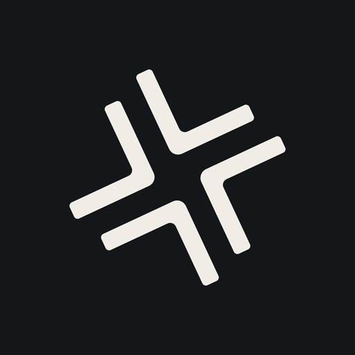
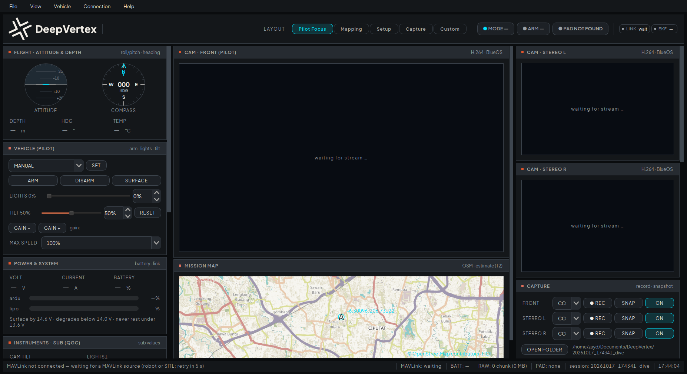
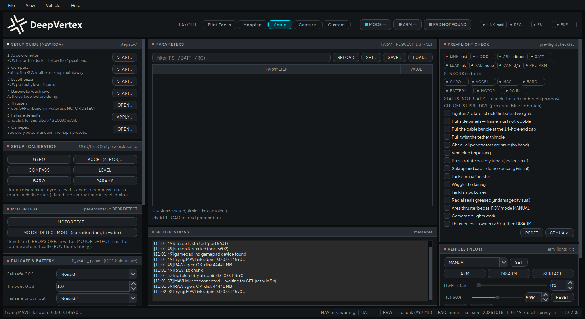
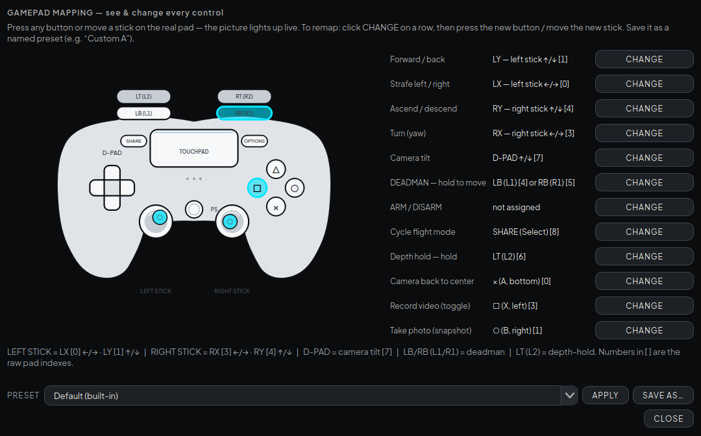

<div align="center">



# DeepVertex Marine Technology Console

**BlueROV2 mission console for coral-mapping surveys — ROV mode.**

**BlueOS-compatible. Tested on the BlueROV2.**

A QGroundControl-style topside application (PySide6) for the BlueRobotics BlueROV2:
three live camera streams, full MAVLink telemetry, gamepad teleop with safety
interlocks, compressed **and** onboard-RAW capture with a clear per-dive file layout,
pre-flight sensor health, failsafe management, and calibration tools — designed to be
run by a dive crew, not by a software engineer.

[](https://github.com/ZaydZaidan/deepvertex-console/actions/workflows/ci.yml)


</div>



---

## Why this exists

Underwater survey crews need one screen that answers three questions at all times:
*is the ROV healthy, where is it, and is what I care about being recorded?* This
console is built around that.

- **Safety first** — dead-man enforced teleop, pre-flight sensor health from the
  autopilot itself, leak/battery/temperature/link alerts, and a storage guard that
  physically blocks REC/SNAP before a dive-critical disk fills up.
- **Two qualities of recording, one clean file tree** — compressed video for quick
  review, uncompressed RAW for photogrammetry, per camera, clearly split on disk.
- **Built for the boat** — large legible text at 120% by default, high-contrast ink
  theme for sunlight, everything reachable with the gamepad you already hold.

## Feature highlights

| Area | What you get |
|---|---|
| **Video** | 3 simultaneous streams (front + stereo L/R via BlueOS), 16:9 tiles, live Hz + health, per-tile recording state |
| **Telemetry** | Attitude + compass dials, depth/temperature, battery V/A/%, QGC-style sub instruments, MAVLink tlog per session |
| **Teleop** | PS4 DualShock teleop (evdev), dead-man hold, MAX SPEED 25/50/75/100%, depth-hold, camera tilt + lights with percentages |
| **Capture** | Per-camera **COMPRESSED \| RAW** REC mode, quick SNAP photos, live time-to-full estimate, safety margins + hard block |
| **RAW pipeline** | Onboard agent (BlueOS extension) writes uncompressed chunks on the Pi; TRANSFER pulls them into the session with sha256 verification; Pi auto-stop guard |
| **Pre-flight** | Per-sensor health chips (GYRO / ACCEL / MAG + compass count / BARO / BATTERY / MOTOR / RC), pre-arm bit + latest status text, 15-item Blue Robotics pre-dive checklist with ARM soft-gate |
| **Safety systems** | Leak latch, battery low/critical, water-temperature alerts (editable), FAILSAFE status, link watchdog; red/amber alert strip + beep |
| **Vehicle ops** | Arm/disarm, mode switch, SURFACE, accelerometer/compass/level/baro calibration dialogs, thruster test + MOTOR_DETECT, failsafe editor with one-click defaults (4S 10 Ah), parameter browser with SAVE/LOAD |
| **Maps** | OSM map (offline-capable tile cache), anchor pinning, ROV dead-reckoning track (armed-gated), NED plot |
| **Gamepad page** | Painted DS4 diagram with live button/stick feedback, one-click remap, named presets (e.g. "Custom A") auto-loaded per machine, pad REC/PHOTO buttons |
| **UX** | 4 layouts (Pilot Focus / Mapping / Setup / Capture), global text scale (100/120/140%), ink & ivory themes, English-only UI, session naming, per-machine settings in `gui_t1/saved/` |

<table>
<tr>
<td></td>
<td></td>
</tr>
<tr>
<td align="center"><em>Setup layout — guided calibration & failsafe</em></td>
<td align="center"><em>Gamepad mapping — DS4 diagram, remap, presets</em></td>
</tr>
</table>

## Hardware & software

| Piece | Model |
|---|---|
| ROV | BlueRobotics BlueROV2 (Navigator + Raspberry Pi 4, BlueOS) |
| Front camera | Blue Robotics Low-Light HD USB (RAW ≤ 640×480 over USB2) |
| Stereo camera | **Arducam B0495C** — 2× AR0234 global shutter, YUYV 1920×1200 (streams at 1280×720@30) |
| Battery | Tattu 4S 10000 mAh LiPo (25C) — failsafe defaults preset for this pack |
| Topside | Ubuntu 24.04 laptop, tether via Fathom-X (BlueOS at `192.168.2.2`) |
| Controller | Sony DualShock 4 (USB) |

## Downloads (v1.0.1)

Available on the release page:
<https://github.com/ZaydZaidan/deepvertex-console/releases/tag/v1.0.1>

| Platform | Artifact | For |
|---|---|---|
| **Linux (Ubuntu/Debian-based)** | `deepvertex-console-v1.0.1-linux.tar.gz` | Topside laptop (full feature set: teleop, streams, recorder, calibration…) |
| **Windows** | `DeepVertexMarineConsole.exe` | Windows desktop (MAVLink telemetry, panels, parameters, recorder — scope note below) |

### A. Install on Ubuntu / other Linux (terminal)

```bash
# 1) Download & extract
wget https://github.com/ZaydZaidan/deepvertex-console/releases/download/v1.0.1/deepvertex-console-v1.0.1-linux.tar.gz
tar xzf deepvertex-console-v1.0.1-linux.tar.gz
cd deepvertex-console-1.0.1

# 2) One-time topside install (builds .venv: PySide6, evdev, pymavlink,
#    numpy; apt deps: python3-gi + GStreamer tools/plugins; pip fallback)
./install/install_topside.sh

# 3) Launch (robot on the tether, BlueOS at 192.168.2.2)
./gui_t1/run_console_real.sh --raw-agent http://192.168.2.2:8765

# Optional launcher installed for future sessions (add ~/.bashrc):
echo 'alias deepvertexrov="'$(pwd)'/gui_t1/run_console_real.sh --raw-agent http://192.168.2.2:8765 --tema ink --teks 1.2"' >> ~/.bashrc
source ~/.bashrc && deepvertexrov        # == same console, one word
```

Then (from the tar.gz walk-through): the script **installs everything it
needs** into `gui_t1/.venv` — you do not need a system-wide Python install;
`--mavlink`, `--outdir`, `--preset`, `--nome`, see `run_console_real.sh
--help` for the full option list.

### B. Install on Windows (.EXE)

1. Download **`DeepVertexMarineConsole.exe`** from the release page.
2. Double-click it (no installer — one-file portable). It connects to the
   MAVLink feed (`udpin:0.0.0.0:14550` by default) and opens the console.
3. Optional for **camera recording**: install the
   [GStreamer runtime](https://gstreamer.freedesktop.org/download/)
   (*runtime MSI + the matching "devel" pack*), then make sure its `bin`
   folder is on PATH — `gst-launch-1.0` must resolve in a terminal.
4. The gamepad teleop side is Linux-only for now (evdev); the EXE shows an
   honest "not available on this platform" instead of breaking (**recording,
   telemetry and all panels stay usable**).

Terminal option list (works for both): `--help` shows `--mavlink`,
`--outdir`, `--preset`, `--nama-sesi`, ports and more.

Use terminal equivalents on Windows:

```powershell
# from PowerShell
Invoke-WebRequest -Uri "https://github.com/ZaydZaidan/deepvertex-console/releases/download/v1.0.1/DeepVertexMarineConsole.exe" -OutFile "DeepVertexMarineConsole.exe"
.\DeepVertexMarineConsole.exe           # console starts
.\DeepVertexMarineConsole.exe --help    # option list (session dir, ports…)
```

Windows scope note: the .EXE runs MAVLink telemetry, camera **recording** &
snapshots (with the GStreamer runtime), parameter/preflight panels and capture
management — live **video preview** and the **gamepad** are Linux-side
(evdev/PyGObject) until a Windows-native reader ships. Sources remain
buildable everywhere (this repository).

## Quick start

```bash
# 1) Topside install (venv + PySide6 + GStreamer checks)./install/install_topside.sh

# 2) Launch (defaults: ink theme, 120% text, RAW agent at the robot)./gui_t1/run_console_real.sh --raw-agent http://192.168.2.2:8765

# …or the launcher installed on the field laptop:
deepvertexrov
```

First run asks for a **session name**; everything from that dive lands in
`~/DeepVertex-ROV-Captures/<date>_<time>_<name>/` (see
[docs/files-and-storage.md](docs/files-and-storage.md)).

Full documentation index: [docs/](#documentation).

## Documentation

| Document | For |
|---|---|
| [docs/installation.md](docs/installation.md) | Topside + onboard install, tether & BlueOS setup, verification |
| [docs/quickstart.md](docs/quickstart.md) | Your first 15 minutes: pre-flight, arm, fly, record, transfer |
| [docs/user-guide.md](docs/user-guide.md) | Every panel, layout, alert and menu — the operator manual |
| [docs/gamepad.md](docs/gamepad.md) | Default DS4 mapping, remapping, named presets, safety blocking |
| [docs/files-and-storage.md](docs/files-and-storage.md) | Session folder layout, compressed vs RAW, storage guard, `saved/` |
| [docs/architecture.md](docs/architecture.md) | Modules, threads, MAVLink layer, agent protocol, theming |
| [docs/testing.md](docs/testing.md) | Test suite, probes, fake vehicle, agent test mode |
| [docs/troubleshooting.md](docs/troubleshooting.md) | Field-proven fixes for the issues we actually hit |
| [docs/roadmap.md](docs/roadmap.md) | Autonomy + VIO (next), known limitations |
| [CHANGELOG.md](CHANGELOG.md) | Release history |
| [CONTRIBUTING.md](CONTRIBUTING.md) | Dev environment, conventions, PR flow |
| [SECURITY.md](SECURITY.md) | Vulnerability reporting & scope |

## Repository layout

```
gui_t1/          The console (PySide6) — see gui_t1/README_WORKING_NOTES.md for work notes
onboard/         raw_agent.py + BlueOS extension scaffold (onboard RAW recorder)
tests/           Hardware-free suite (30 checks), layout/scroll/pad probes,
                 fake_vehicle.py, tether link check, parameter dump tools
install/         install_topside.sh — one-shot topside setup
docs/            Operator & developer documentation (this folder)
progress/        Engineering log for the delivery (chronological)
```

## Testing

The full suite runs without hardware (own fake autopilot + GStreamer test pipelines):

```bash
cd gui_t1.venv/bin/python../tests/test_console.py     # 30 checks — PASS.venv/bin/python../tests/test_video.py.venv/bin/python../tests/test_raw.py.venv/bin/python../tests/probe_layout.py     # geometry/truncation scan, 4 layouts.venv/bin/python../tests/probe_scroll.py     # no-clip + scroll reachability scan.venv/bin/python../tests/probe_padmap.py     # gamepad page + live-highlight shots
```

CI runs the same suite headlessly on every push (see `.github/workflows/ci.yml`).

## Status & roadmap

**ROV mode is feature-complete and field-tested** on the real BlueROV2 over
the tether — teleop, capture, RAW transfer, failsafe and calibration flows were all
exercised on hardware. autonomy (next) locks in autonomous operation (AUV mode + VIO) on the
Orin companion. Known limitations are listed in [docs/roadmap.md](docs/roadmap.md).

## Links

| | |
|---|---|
| Website | [deepvertex.tech](https://deepvertex.tech) |
| Instagram | [@deepvertex](https://instagram.com/deepvertex) |
| LinkedIn | [DeepVertex](https://www.linkedin.com/company/deepvertex) |
| Business & licensing | founders@deepvertex.tech |

## License

**PolyForm Strict 1.0.0 — source-available.** You may read, run and use this
software for any **noncommercial** purpose. You may **not** distribute it or make
**changes / new works** based on it, and commercial use requires a **written
license** — contact [founders@deepvertex.tech](mailto:founders@deepvertex.tech).
DeepVertex names, logos and branding must never be removed or altered.
See [LICENSE](LICENSE); third-party components keep their own licenses
([THIRD_PARTY_NOTICES.md](THIRD_PARTY_NOTICES.md) — PySide6/Qt/GStreamer under
LGPL, dynamically linked, unmodified).
