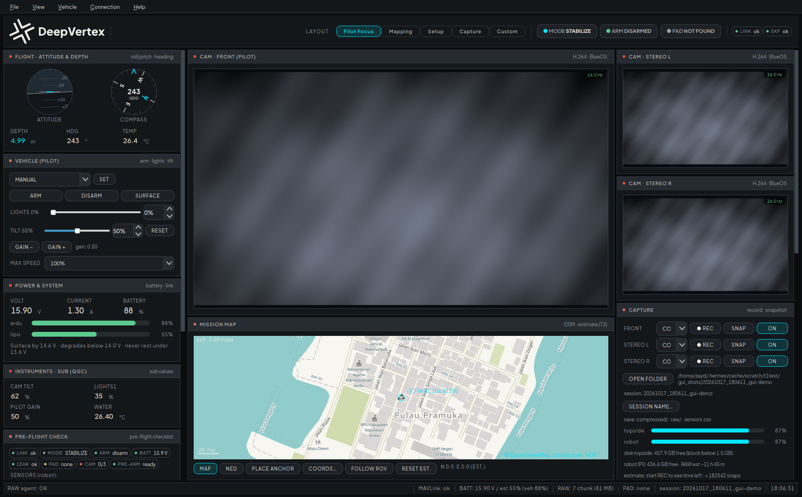
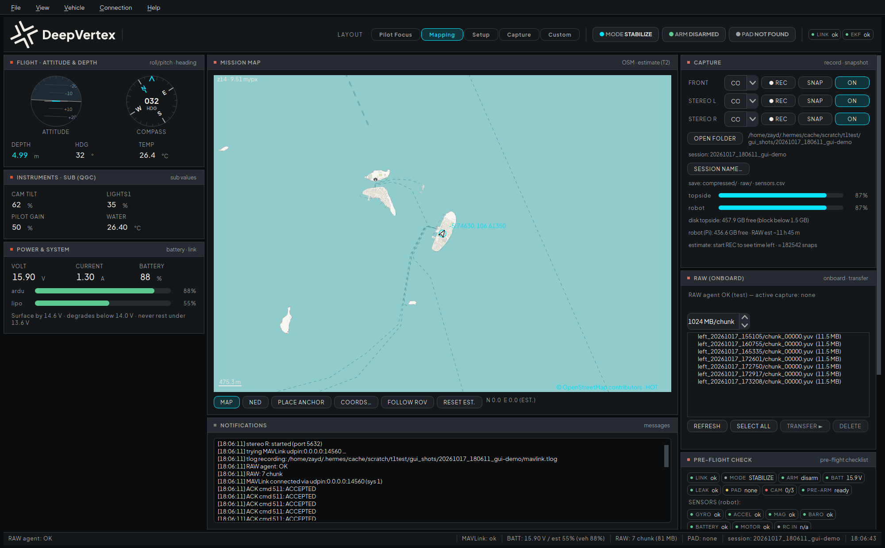
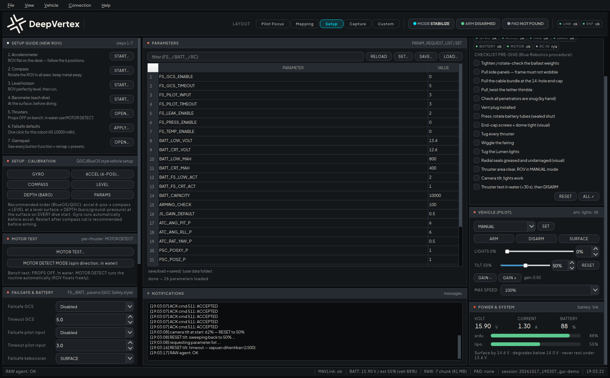
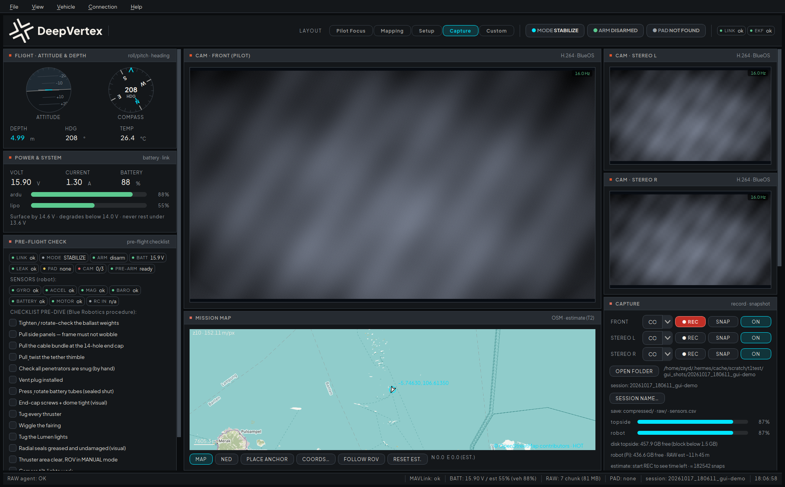
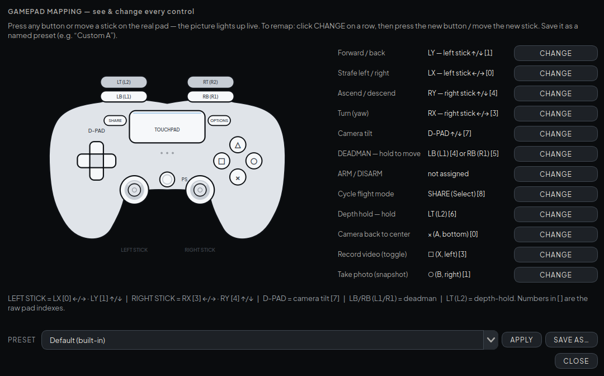
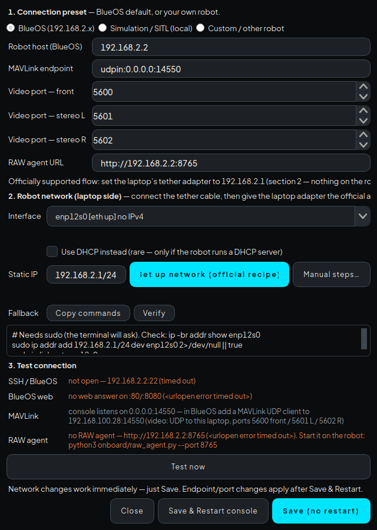

<div align="center">


# DeepVertex Marine Technology Console

### The mission console built for coral-mapping dives.

**Available for Windows 10/11 and Ubuntu 24.04 — one installer, two platforms, one workflow.**
BlueOS-compatible · field-tested on the BlueROV2.

A QGroundControl-style topside application (PySide6) that puts the whole dive on one
screen: live cameras, full telemetry, RAW + compressed capture, storage that manages
itself, and a sensor record you can take home after every session.

[](https://github.com/ZaydZaidan/deepvertex-console/actions/workflows/ci.yml)


</div>



---

> ## 🚀 A ground station that completes the mission — not just flies it.

## ⭐ Flagship features

**🗺️ The mapping workflow, engineered end-to-end**
Most ground stations stop at *“record video”*. This console delivers a *survey*:
every dive lands in its own session folder with **photogrammetry-grade RAW and
compressed video captured at the same time, per camera**, a 10 Hz sensor CSV, the
full MAVLink tlog — and map anchors that remember where yesterday ended.
The dive decides the format. Not the app.

**🤖 The robot has one job: fly. Everything else runs topside.**
Sensor logging, storage math, map rendering, RAW transfer control — all computed
on your laptop, none on the vehicle. The camera **ON/OFF buttons stop the stream
inside BlueOS itself**, so the Raspberry Pi stops encoding the moment you stop
watching. Less CPU on the robot means cooler electronics and longer bottom time.

**📡 One click to connect — the official way.**
Pick the tether adapter, press one button: your laptop becomes **192.168.2.1**,
and **Verify** proves it live — adapter state plus a real answer from the robot.
No terminal, no forum hunting, no guesswork. And nothing on the robot is ever
modified.

**🎥 Cameras scale with the mission.**
Front and stereo today — a fourth, fifth, sixth camera tomorrow. The video
pipeline is modular by design: resolution, ports and sources are configuration,
not code. Your console grows with your payload.

**💾 Storage that refuses to lose your dive.**
A live time-to-full estimate, soft margins, and a **hard block before a
dive-critical disk fills up**. RAW chunks transfer sha256-verified and clear in
bulk. Every session stays in its own folder, one button away.

**🧰 Setup that a dive crew can actually follow.**
A 7-step new-ROV guide, **one-click failsafe defaults** for the 4S pack, guided
accelerometer/compass/barometer calibration, a thruster test, and a 15-point
pre-dive checklist that gates ARM. Engineer-grade depth, crew-grade clarity.

**🕹️ Ergonomics learned on real decks.**
Dead-man enforced gamepad teleop, **custom named mappings you can swap between
pilots**, a sunlight-readable theme, 120% type by default, and a wheel-guard so
scrolling never bumps a slider or dropdown by accident.

**Coming from a generic GCS? Here's everything you're adding:**
an onboard RAW pipeline with verified bulk transfer · per-camera RAW/compressed
modes · a storage guard that can actually block capture · session folders with
saved map anchors · topside sensor CSV · one-button official network setup ·
capture controls that free the robot's CPU. *That's the difference between a
flight tool and a survey tool.*

## 📸 Every layout, one keystroke

Four purpose-built layouts share the same live state — switch mid-dive without
losing a thing.

| | |
|---|---|
|  |  |
| 🎯 **Pilot Focus** — fly the vehicle: attitude & compass, depth, power, front camera big, stereo beside it, capture controls at hand. | 🗺️ **Mapping** — plan and record: full OSM map + notifications, capture with storage bars, RAW transfer panel, instruments. |
|  |  |
| 🧰 **Setup** — the technical bench: 7-step guide, calibration, thruster test, failsafe editor, complete parameter browser. | 📷 **Capture** — all three cameras with RAW/compressed switches, session storage, RAW file management, teleop. |

## 🎮 Custom gamepad mapping

Every control visible, every control changeable — click **CHANGE**, press the new
button on the real pad, save the result as a named preset (e.g. “Custom A”) and
switch presets between pilots.



## 🔌 Connection dialog — the official flow, one button

No terminal required: choose the adapter, apply the official BlueRobotics setting,
verify it live. The robot side is never touched.



## ⚡ Quick start

1. **Install** — run the Windows installer from the releases page (per-user, no
   admin needed; shows the End-User Terms and lets you choose the install folder).
   Ubuntu runs from the project's virtual environment.
2. **Connect** — plug the tether, open **Connection ▸ Set up network**, apply and
   **Verify**. No restart needed — press **Save**.
3. **Launch** — telemetry comes alive on `udpin:0.0.0.0:14550`. The first
   SNAP/RECORD of each dive asks once: default folder (`Documents/DeepVertex`) or
   choose your own.
4. **Dive** — pick a layout, record what matters, fly.

**Windows note:** if camera tiles stay black while telemetry works, allow the
video ports once in an admin PowerShell (Windows blocks inbound UDP by default):

```powershell
New-NetFirewallRule -DisplayName "DeepVertex Video UDP In" -Direction Inbound `
  -Protocol UDP -LocalPort 5600-5602 -Action Allow -Profile Any
```

## 📂 Where your files live

```
Documents/DeepVertex/                    <- created at install / first run
├─ logs/console.log                      <- application log (easy to find)
└─ <YYYYMMDD_HHMMSS>_<session-name>/     <- one folder per dive
    ├─ compressed/                       <- snap .png + recording .mkv
    ├─ raw/                              <- uncompressed chunks from the robot
    ├─ mavlink.tlog                      <- full-fidelity MAVLink log
    └─ sensors.csv                       <- 10 Hz sensor log (topside)
```

## ⬇️ Downloads

**Windows 10/11** → [`DeepVertexMarineConsole-Setup-1.1.7.exe`](https://github.com/ZaydZaidan/deepvertex-console/releases/latest)
— installer with End-User Terms, install-folder choice and uninstaller. Bundles
everything it needs (camera decoding included); no extra runtime required.

**Ubuntu 24.04** → run the project from its virtual environment (`gui_t1/` —
see [docs/installation.md](docs/installation.md)).

The application checks for updates on startup (silent when offline); opt out with
`--no-update` or `DV_NO_UPDATE=1`.

## 🧪 Testing

The suite runs without hardware (its own fake autopilot + GStreamer test pipelines):

```bash
cd gui_t1
.venv/bin/python ../tests/test_console.py     # 68 checks — PASS
.venv/bin/python ../tests/test_video.py
.venv/bin/python ../tests/test_raw.py
.venv/bin/python ../tests/probe_layout.py     # geometry scan, 4 layouts
.venv/bin/python ../tests/probe_scroll.py     # no-clip + scroll reachability
```

CI runs the same suite headlessly on every push.

## 📚 Documentation

- 🧾 [docs/installation.md](docs/installation.md) — topside install, tether & BlueOS setup, verification
- 🚀 [docs/quickstart.md](docs/quickstart.md) — your first 15 minutes: pre-flight, arm, fly, record, transfer
- 📖 [docs/user-guide.md](docs/user-guide.md) — every panel, layout, alert and menu
- 🎮 [docs/gamepad.md](docs/gamepad.md) — default mapping, remapping, named presets, safety blocking
- 💾 [docs/files-and-storage.md](docs/files-and-storage.md) — session layout, compressed vs RAW, storage guard
- 🏗️ [docs/architecture.md](docs/architecture.md) — modules, threads, MAVLink layer, agent protocol
- 🧪 [docs/testing.md](docs/testing.md) — test suite, probes, fake vehicle, agent test mode
- 🚑 [docs/troubleshooting.md](docs/troubleshooting.md) — field-proven fixes (incl. the Windows video firewall)
- 🪟 [docs/platform-parity.md](docs/platform-parity.md) — Windows/Linux feature audit
- 📜 [CHANGELOG.md](CHANGELOG.md) — full release history

## 🚦 Status & roadmap

**ROV mode is feature-complete and field-tested** on the real BlueROV2 over the
tether, on both Windows and Ubuntu: teleop, capture, RAW transfer, pre-flight,
failsafe and calibration flows. Next (2.x): autonomous operation (AUV mode + VIO)
on the Orin companion. Known limitations: [docs/roadmap.md](docs/roadmap.md).

## 🔗 Links

- 🌐 Website — [deepvertex.tech](https://deepvertex.tech)
- 📷 Instagram — [@deepvertex](https://instagram.com/deepvertex)
- 💼 LinkedIn — [DeepVertex](https://www.linkedin.com/company/deepvertex)
- ✉️ Business & licensing — founders@deepvertex.tech

## 📄 License

**PolyForm Strict 1.0.0 — source-available.** You may read, run and use this
software for any **noncommercial** purpose. You may **not** distribute it or make
**changes / new works** based on it, and commercial use requires a **written
license** — contact [founders@deepvertex.tech](mailto:founders@deepvertex.tech).
DeepVertex names, logos and branding must never be removed or altered.
See [LICENSE](LICENSE); third-party components keep their own licenses
([THIRD_PARTY_NOTICES.md](THIRD_PARTY_NOTICES.md) — PySide6/Qt under LGPL,
dynamically linked, unmodified; bundled ffmpeg is used as an unmodified separate
executable).
